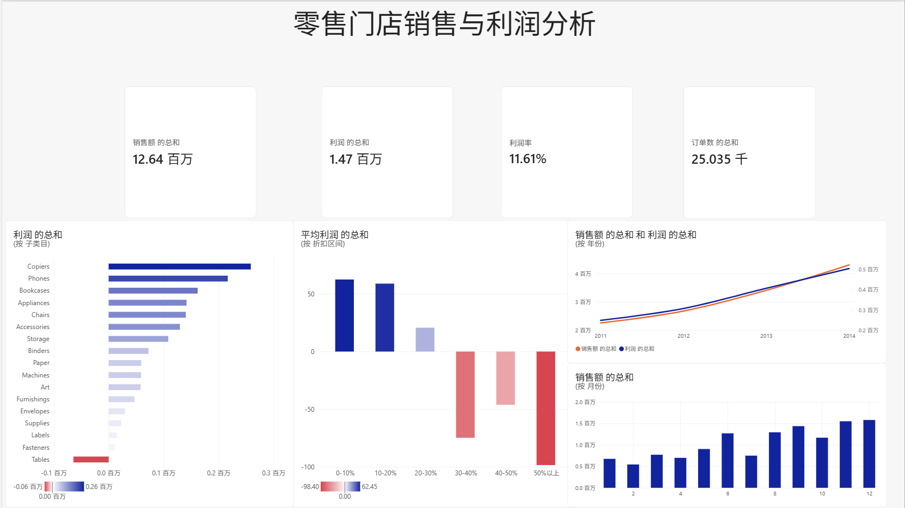
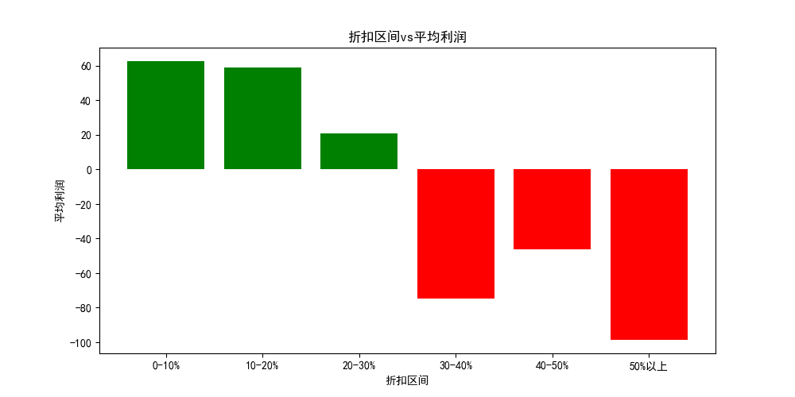
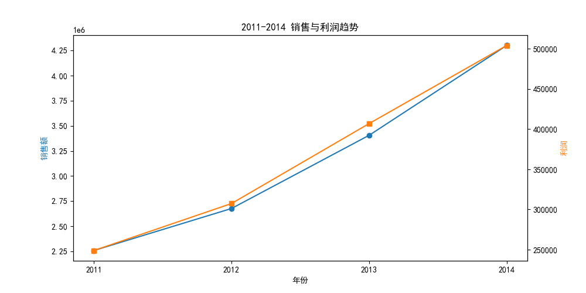
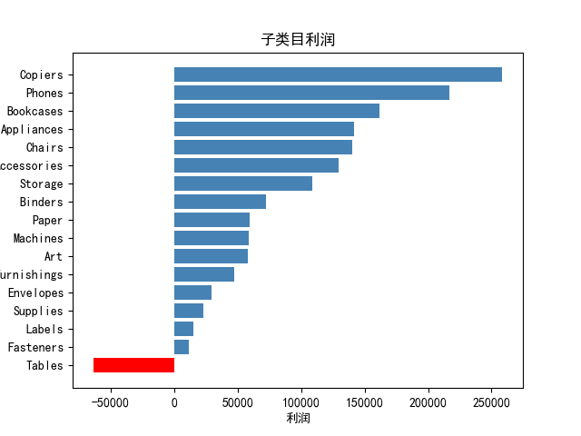
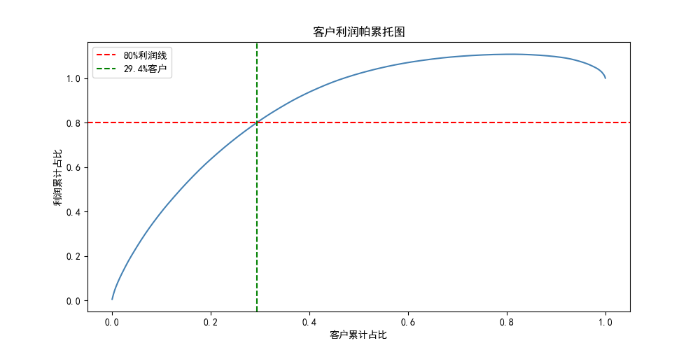
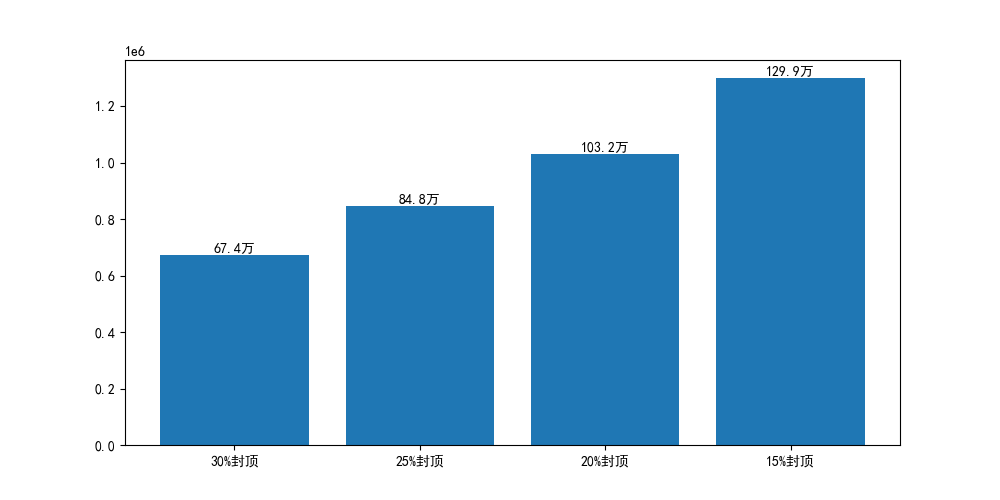

# 零售门店销售与利润分析

围绕「**怎样卖出更多、赚得更多**」这一业务命题，分析 **5.1 万条**全球零售订单数据（2011-2014），识别利润流失的主因，并给出可落地的优化方案。



## 数据

- **来源**：Kaggle Superstore 数据集（全球零售连锁超市 4 年订单）
- **规模**：51,290 行 × 24 列 / 25,035 个订单 / 1,590 个客户 / 10,292 个产品
- **时间跨度**：2011-01-01 ~ 2014-12-31
- **核心字段**：Order Date、Customer ID、Category、Sub-Category、Sales、Quantity、Discount、Profit、Shipping Cost

## 方法

1. **数据入库** —— 处理编码（latin-1）与混合日期格式（斜杠/横杠），导入 SQLite
2. **数据质量检查** —— 发现 Postal Code 缺失 80.5%、折扣最高 85%、存在亏损订单
3. **SQL 分析** —— 经营总览、产品结构、折扣红线、时间维度、区域市场、客户帕累托
4. **方案测算** —— 折扣封顶的利润影响测算 + 敏感性分析
5. **可视化** —— Python（matplotlib）+ Power BI 交互式仪表板

## 核心发现

### 1. 经营总览

| 指标 | 数值 |
|------|------|
| 总销售额 | $12,642,502 |
| 总利润 | $1,467,457 |
| **利润率** | **11.6%** |
| 订单数 | 25,035 |
| 客单价 | $505 |

### 2. 折扣红线：30% ⭐



| 折扣区间 | 平均每单利润 |
|---------|-------------|
| 0-10% | +$62 |
| 10-20% | +$59 |
| 20-30% | +$21 |
| **30-40%** | **−$75** |
| 40-50% | −$46 |
| 50% 以上 | −$98 |

**折扣超过 30%，每卖一单亏一单。**

**越线订单的代价**：

| 指标 | 数值 |
|------|------|
| 折扣 > 30% 的订单 | **10,361 单**（占全部 41.4%）|
| 这些订单的销售额 | $1,736,588（占全店 13.7%）|
| **这些订单的总利润** | **−$793,526** |

> **41.4% 的订单吃掉了全店 55% 的利润。**

### 3. 三重印证：折扣是核心问题

| 维度 | 高折扣对象 | 结果 |
|------|-----------|------|
| **子类目** | Tables（平均折扣 29.1%） | **唯一亏损子类目**（利润率 −8.46%）|
| **全店** | 折扣 ≥30% 的订单 | 10,361 单亏损 79.4 万 |
| **地区** | Southeast Asia（平均折扣 27.2%） | **利润率仅 2.02%** |

折扣与利润率几乎完全负相关（Canada 折扣 0% → 利润率 26.6%；东南亚折扣 27.2% → 利润率 2.0%）。

### 4. 时间维度



| 年份 | 销售额 | 利润 | 同比增长 |
|------|--------|------|---------|
| 2011 | $2,259,451 | $248,941 | — |
| 2012 | $2,677,439 | $307,415 | +18.5% |
| 2013 | $3,405,746 | $406,935 | +27.2% |
| 2014 | $4,299,866 | $504,166 | +26.3% |

- **4 年销售额翻倍（+90%）**，处于高速增长期
- **季节性**：9-12 月旺季（12 月最旺），1-2 月淡季 → **Q4 前需加大备货**

### 5. 子类目利润：Tables 是唯一亏损项



- 17 个子类目中，**仅 Tables（桌子）亏损**：销售额 75.7 万，亏损 6.4 万
- 去掉 Tables 后，Furniture 品类利润率从 6.94% 提升至 10.4%
- 利润最高：Copiers（复印机）25.9 万

### 6. 客户帕累托



**467 个客户（29.4%）贡献了 80% 的利润。**

- 接近但不同于经典二八定律 → 客户集中度不算极端，抗风险能力较好
- 曲线末段回落，说明存在**负贡献客户**（吃掉他人利润）

## 优化方案

### 方案一：折扣封顶

测算逻辑：把折扣超过阈值的订单，折扣降到阈值，重新计算利润：

```
新利润 = Sales × (1-阈值)/(1-原折扣) − (Sales − Profit)
```

| 折扣上限 | 受影响订单 | 原利润 | 优化后利润 | **可挽回利润** |
|---------|-----------|--------|-----------|--------------|
| 30% | 10,361 | −$793,526 | −$119,842 | **+$673,685** |
| 25% | 11,089 | −$814,887 | **+$33,408** | **+$848,295** |
| 20% | 11,328 | −$814,682 | +$217,806 | **+$1,032,488** |
| 15% | 17,061 | −$668,803 | +$630,055 | **+$1,298,858** |



### 方案二：处理亏损产品

- 优先下架/调价亏损最严重的单品（Tables 系列、高价打印机、储物柜）
- 典型：Cubify 3D 打印机（3 单亏 8,880）、Lexmark 打印机（4 单亏 4,590）

### 方案假设与风险

**假设**：
1. 折扣提高后，客户仍保持相同购买量（价格弹性低）
2. 下架亏损产品不影响客户对其他产品的购买
3. 采购与运营成本不变

**风险**：

| 风险 | 说明 | 影响 |
|------|------|------|
| 客户流失 | 折扣收紧后客户可能转向竞品 | 测算利润为**上限值**，实际收益更低 |
| 连带销售 | 下架亏损品导致客户放弃整单 | 损失该客户其他购买 |
| 执行阻力 | 销售团队担心业绩而抵制 | 落地难度 |

**应对**：
1. 先选 1-2 个地区/品类**小范围试点 3 个月**
2. 监控订单量、客单价、客户留存率、复购率
3. 设置止损线，订单量下降超过阈值立即回滚
4. 先收紧折扣（见效快），再处理亏损产品（需评估连带）

**保守估计**：考虑客户流失，实际可挽回利润约为测算值的 **50%~70%**
→ **25% 封顶方案：预估可挽回 42~59 万美元**

## 结论

> 通过 6 个维度的分析发现，**折扣过高是利润流失的主因**（子类目、全店、地区三重印证）。
> 测算显示将折扣上限设为 30% 可挽回约 **67 万美元**利润（上限值），保守估计 **42~59 万美元**。
> 建议选 **25% 作为试点上限**，小范围试行 3 个月后再推广。

## 技术栈

`Python`（pandas / matplotlib）· `SQL`（SQLite）· `Power BI`

## 项目结构

```
├── README.md
├── analysis.ipynb            # 分析代码（Jupyter Notebook，含说明）
├── retail_dashboard.pbix     # Power BI 仪表板源文件
├── charts/                   # 分析图表
│   ├── dashboard.png
│   ├── discount_profit.png
│   ├── yearly_trend.png
│   ├── sensitivity_analysis.png
│   ├── subcategory_profit.png
│   └── customer_pareto.png
└── data/                     # 聚合结果（供 BI 使用）
    ├── yearly_trend.csv
    ├── monthly_seasonality.csv
    ├── subcategory_profit.csv
    ├── discount_profit.csv
    ├── customer_profit.csv
    └── order_count.csv
```

## 复现步骤

1. 下载 Superstore 数据集（Kaggle）
2. 用 `analysis.ipynb` 第 1 个 cell 导入 SQLite（注意 `encoding="latin-1"` 和日期格式统一）
3. 依次运行后续 cell，完成分析与绘图
4. 用 `data/` 中的 CSV 在 Power BI 中搭建仪表板
